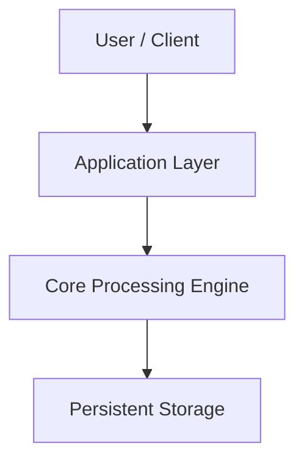

# <Project Name> — <Page Title>

> **Executive Summary:** Brief callout explaining what the software does and who this guide is for.
{.is-info}

---

## 1. Overview & Key Capabilities

| Capability | Description | Key Modules / Files |
|---|---|---|
| **Core Engine** | High-level description of core functionality | `src/core/` |
| **User Interface / CLI** | How users interact with the software | `src/cli.py`, `src/ui/` |

---

## 2. System Architecture



---

## 3. Quickstart & Usage Manual

### Installation

```bash
# Example setup commands
git clone ...
```

### Configuration & Daily Operation

Document key workflows, flags, environment variables, and troubleshooting steps here.
